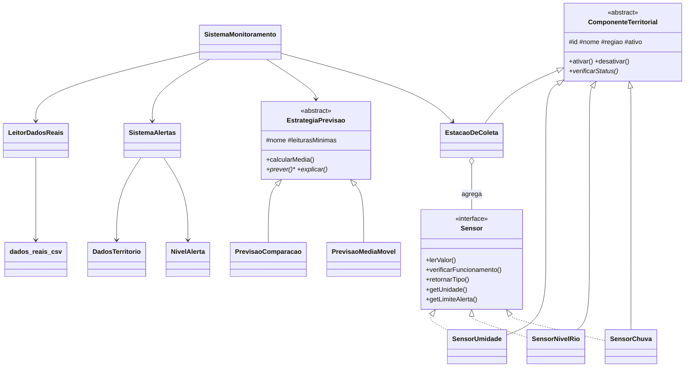

<h1 align="center">Territory Predictive Insights</h1>

<p align="center">
  <strong>CitizenTech · Monitoramento territorial preditivo para risco de alagamento</strong><br>
  Global Solution 2º/2026 — Programação Orientada a Objetos (POO) · FIAP
</p>

<p align="center">
  
  
  
  
  
</p>

---

Plataforma de monitoramento territorial que **lê medições de sensores**, **gera previsões
simples** e **emite alertas automáticos** fundamentados nas leituras. A pergunta que o
sistema ajuda a responder é:

> *"Qual problema vai atingir o nosso território nos próximos dias, e o que podemos
> fazer hoje para evitar ou reduzir o impacto?"*

**Recorte escolhido:** clima local — chuva intensa e risco de alagamento em pontos
vulneráveis. Funciona em modo **simulado** (leituras aleatórias realistas) ou com
**dados reais** de fonte pública (Open-Meteo), carregados offline de um CSV.

---

## Sumário

- [Público beneficiado](#público-beneficiado)
- [Funcionalidades](#funcionalidades)
- [Arquitetura](#arquitetura)
- [Conceitos de POO aplicados](#conceitos-de-poo-aplicados)
- [Estrutura de arquivos](#estrutura-de-arquivos)
- [Como compilar e rodar](#como-compilar-e-rodar)
- [Roteiro de uso](#roteiro-de-uso)
- [Níveis de alerta](#níveis-de-alerta)
- [Dados reais: fonte, licença e transparência](#dados-reais-fonte-licença-e-transparência)
- [Reflexão crítica](#reflexão-crítica)
- [Uso de IA](#uso-de-ia)
- [Divisão de tarefas](#divisão-de-tarefas)
- [Decisões da equipe](#decisões-da-equipe)
- [Roadmap](#roadmap)

---

## Público beneficiado

Moradores de áreas vulneráveis a alagamento (encostas, várzeas, margens de rio) e a
organização comunitária / defesa civil local que precisa decidir, por exemplo:

- vale a pena acionar a rota de evacuação preventiva?
- em quais pontos concentrar sacos de areia, bombas ou equipes?
- quando comunicar idosos e pessoas com mobilidade reduzida para se anteciparem?

O sistema **não decide** por essas pessoas: ele organiza leituras e previsões para
**apoiar** a decisão de quem conhece o território. O território é descrito por
**região e equipamento** (ex.: "Vila Esperança", "Estação Central"), nunca por
indivíduos — não há nomes, CPF ou endereços de pessoas reais.

## Funcionalidades

| Recurso | Descrição |
|---|---|
| **Sensores** | Chuva (mm/h), nível do rio (m) e umidade do solo (%), com verificação de funcionamento, limite de alerta e detecção de valor acima do limite. |
| **Previsão** | Duas estratégias sobre o histórico (`ArrayList`): **média móvel** e **comparação de períodos**, com valor previsto + explicação e rótulo de confiança. |
| **Alertas automáticos** | Comparam a previsão com o limiar do território e classificam em 4 níveis, explicando o porquê de cada alerta. |
| **Dados protegidos** | População, região e limiares encapsulados; alterações validadas e limiares protegidos por código de acesso. |
| **Menu interativo** | Loop com entrada do usuário para todas as operações. |
| **Dados reais (bônus)** | Carrega CSV com medições reais do Open-Meteo e roda as previsões sobre elas — offline. |
| **Simulação temporal (bônus)** | Replay hora a hora do período real ou simulação de 24h, com resumo da evolução do risco. |

## Arquitetura



**Fluxo principal:** `SistemaMonitoramento` (menu) coleta leituras na `EstacaoDeColeta`
→ aplica as `EstrategiaPrevisao` sobre o histórico → `SistemaAlertas` compara o valor
previsto com os limiares de `DadosTerritorio` e emite o `NivelAlerta` correspondente.
Opcionalmente, `LeitorDadosReais` substitui o histórico simulado por dados reais do CSV.

## Conceitos de POO aplicados

Mapa direto para os critérios de correção:

| Critério | Onde está | Como foi cumprido |
|---|---|---|
| **Classe abstrata** | `ComponenteTerritorial` | `abstract`, não instanciável; atributos `protected` comuns; método abstrato `verificarStatus()` obrigatório nas subclasses. |
| **Interface (≥3 impl.)** | `Sensor` | Contrato implementado por `SensorChuva`, `SensorNivelRio`, `SensorUmidade` (`implements Sensor`), tratados de forma uniforme (polimorfismo). |
| **Encapsulamento** | `DadosTerritorio` | Todos os atributos `private`; `codigoAcesso` **sem getter**; setters validam e rejeitam valores inválidos mantendo o anterior; limiares exigem código correto. |
| **Herança (≥2 subclasses)** | `EstrategiaPrevisao` | Base abstrata com `PrevisaoMediaMovel` (`tamanhoJanela`) e `PrevisaoComparacao` (`tamanhoPeriodo`); ambas sobrescrevem `prever()`/`explicar()` e usam `super(...)`. |
| **Sistema de alertas** | `SistemaAlertas` + `NivelAlerta` | Compara previsão × limiar, classifica em níveis proporcionais e explica o motivo (sensor, valor, limite, excesso em % e valor). |

<details>
<summary><strong>Detalhamento de cada conceito</strong></summary>

### Classe abstrata (`ComponenteTerritorial`)
- É `abstract` e **não pode ser instanciada**.
- Atributos comuns `protected`: `id`, `nome`, `regiao`, `ativo`.
- Métodos concretos herdados: `ativar()`, `desativar()`, `identificacao()`.
- Método **abstrato** `verificarStatus()` que toda subclasse é obrigada a implementar.
- Herdam dela: `SensorChuva`, `SensorNivelRio`, `SensorUmidade` e `EstacaoDeColeta`.

### Interface (`Sensor`)
- Contrato: `lerValor()`, `verificarFuncionamento()`, `retornarTipo()`, `getUnidade()`, `getLimiteAlerta()`.
- Implementada por **3 classes**; o sistema coleta leituras e roda previsões de forma polimórfica.

### Encapsulamento (`DadosTerritorio`)
- **Todos os atributos são `private`**; o `codigoAcesso` **não tem getter**.
- Setters com validação: população negativa/absurda é rejeitada; região vazia é rejeitada; limiares fora da faixa são rejeitados.
- Alterar limiares **exige o código de acesso correto**; tentativa inválida gera mensagem clara e **mantém o valor anterior**.

### Herança (`EstrategiaPrevisao`)
- Base `abstract` com `nome`, `leiturasMinimas` e métodos reaproveitáveis (`calcularMedia`, `temLeiturasSuficientes`).
- `PrevisaoMediaMovel` → atributo `tamanhoJanela`; `PrevisaoComparacao` → atributo `tamanhoPeriodo`.
- Ambas usam **`super(...)`** no construtor e **`super.calcularMedia(...)`** / **`super.temLeiturasSuficientes(...)`**.

### Sistema de alertas (`SistemaAlertas` + `NivelAlerta`)
- Compara o valor **previsto** com o limiar protegido do território.
- Cada alerta explica o **porquê**: sensor, valor previsto, limite estourado e em quanto (valor e percentual).

</details>

## Estrutura de arquivos

```
territory-predictive-insights/
├── ComponenteTerritorial.java   # Classe abstrata base de tudo que é instalado
├── Sensor.java                  # Interface (contrato dos sensores)
├── SensorChuva.java             # Sensor de chuva (mm/h)
├── SensorNivelRio.java          # Sensor de nível do rio (m)
├── SensorUmidade.java           # Sensor de umidade do solo (%)
├── EstacaoDeColeta.java         # Agrupa sensores e guarda histórico
├── EstrategiaPrevisao.java      # Base abstrata das previsões
├── PrevisaoMediaMovel.java      # Média das últimas N leituras
├── PrevisaoComparacao.java      # Período atual vs. anterior (tendência)
├── DadosTerritorio.java         # Encapsulamento + validação + código de acesso
├── NivelAlerta.java             # Enum NORMAL / ATENÇÃO / ALERTA / CRÍTICO
├── SistemaAlertas.java          # Classifica e explica os alertas
├── SistemaMonitoramento.java    # Classe principal (main) + menu interativo
├── LeitorDadosReais.java        # Carrega o CSV de dados reais (offline)
├── dados_reais.csv              # Dataset real (Open-Meteo, São Paulo, 16–19/01/2026)
├── .gitignore
└── README.md
```

> Todos os arquivos estão no **pacote padrão** (sem `package`), na mesma pasta.

## Como compilar e rodar

**Pré-requisito:** JDK **17 ou superior** (testado com OpenJDK 25).

### Windows (Prompt de Comando ou PowerShell)

```bat
cd territory-predictive-insights
chcp 65001
javac -encoding UTF-8 *.java
java -Dstdout.encoding=UTF-8 -Dfile.encoding=UTF-8 SistemaMonitoramento
```

### Linux / macOS

```bash
cd territory-predictive-insights
javac -encoding UTF-8 *.java
java -Dfile.encoding=UTF-8 SistemaMonitoramento
```

> `-encoding UTF-8` na compilação e `-Dstdout.encoding=UTF-8` na execução garantem
> que os acentos do português apareçam corretamente no console. Sem isso o programa
> ainda funciona, mas alguns caracteres podem sair trocados no Windows.

### Eclipse / IDE

O projeto pode ser importado como projeto Java existente. A pasta de código-fonte
contém os `.java` e o `dados_reais.csv`; a IDE copia o CSV para a pasta de saída (`bin/`)
junto dos `.class`. O programa **localiza o CSV automaticamente** (diretório atual e ao
lado dos `.class`), então a **opção 7 funciona mesmo quando a IDE roda de outra pasta**.
Basta executar `SistemaMonitoramento` como *Java Application*.

## Roteiro de uso

Menu principal:

| Opção | Ação |
|:---:|---|
| 1 | Verificar sensores |
| 2 | Simular próximas leituras (modo aleatório) |
| 3 | Rodar previsões e alertas |
| 4 | Gerenciar dados do território (validações + código de acesso) |
| 5 | Exibir status completo |
| 6 | Simulação temporal (replay real, ou 24h aleatórias) |
| 7 | Carregar dados reais (fonte pública) |
| 0 | Sair |

**Passo a passo sugerido para demonstração:**

1. **Opção 7** → carregar dados reais (ENTER usa `dados_reais.csv`) e já rodar as previsões.
2. **Opção 6** → com dados reais carregados, faz o **replay do período real**; sem eles, simula 24h. Mostra o resumo de alertas.
3. **Opção 2** → simular **5** rodadas (modo aleatório, alimenta o histórico).
4. **Opção 3** → rodar previsões e alertas (média móvel + comparação).
5. **Opção 4** → teste as validações: população negativa (rejeitada); alterar limiar com código errado (rejeitado) e com código certo (aceito).
6. **Opção 5** → status completo. **Opção 0** → sair.

> **Código de acesso padrão dos limiares:** `TERRITORIO2026` (valor de demonstração,
> documentado; pode ser trocado na opção **4 → f**).

## Níveis de alerta

A classificação é proporcional ao quanto o valor **previsto** ultrapassa o limiar:

| Nível | Condição (razão previsto/limiar) | Significado |
|---|---|---|
| **NORMAL** | até 100% do limite | dentro do seguro |
| **ATENÇÃO** | até 10% acima | aproximando do limite |
| **ALERTA** | até 25% acima | limite superado com folga |
| **CRÍTICO** | mais de 25% acima | muito acima do limite |

Limiares padrão (escala horária, coerente com os dados reais): **chuva 8,0 mm/h**,
**nível do rio 4,0 m**, **umidade 85%**. Todos configuráveis pela opção 4 (com código).

## Dados reais: fonte, licença e transparência

O arquivo `dados_reais.csv` contém medições históricas **reais** de precipitação (mm/h)
e umidade relativa (%) para **São Paulo/SP** (lat -23.55, lon -46.63), no período de
**16 a 19/01/2026** — **96 leituras horárias** de um episódio de chuva contínua.

- **Fonte:** [Open-Meteo Historical Weather API](https://open-meteo.com)
  (`archive-api.open-meteo.com`), dados abertos de reanálise meteorológica.
- **Licença:** uso gratuito para fins não comerciais, com atribuição —
  **CC BY 4.0** (<https://open-meteo.com/en/licence>).
- **Chuva e umidade:** valores **reais** de precipitação horária e umidade relativa a 2 m.
- **Nível do rio:** **não** é medição real de régua limnimétrica. É uma **estimativa
  simplificada** derivada da chuva real, por um modelo de precipitação antecedente:

  ```
  API[i] = chuva[i] + 0.85 * API[i-1]
  nivel  = max(2.0, 2.0 + 0.16 * API[i])   # metros
  ```

  Está sinalizada como estimativa no CSV (coluna `nivel_rio_est_m`) para não ser
  confundida com dado observado.

- **Leitura offline:** o programa lê do arquivo; **não depende de internet** para rodar.

**Como reproduzir o dataset** (qualquer navegador/HTTP), aplicando o modelo de nível acima:

```
https://archive-api.open-meteo.com/v1/archive?latitude=-23.55&longitude=-46.63&start_date=2026-01-16&end_date=2026-01-19&hourly=precipitation,relative_humidity_2m&timezone=America/Sao_Paulo
```

## Reflexão crítica

**Quando o sistema deve se calar?** Com poucas leituras, a previsão é frágil. Por isso
cada estratégia declara um mínimo (`leiturasMinimas = 5`) e o sistema rotula a previsão
como *"POUCO CONFIÁVEL"* quando o histórico é curto. A comparação de períodos só é
completa com dois períodos (10 leituras); antes disso avisa que faz comparação parcial.
Um alerta baseado em 1 ou 2 leituras poderia gerar pânico à toa — o sistema sinaliza a
baixa confiança em vez de fingir certeza.

**O que os dados não representam?** Um sensor (ou um ponto de grade da reanálise) por
região diz pouco sobre um ponto específico: a chuva pode ser intensa numa rua e não na
outra. Mesmo os dados **reais** do Open-Meteo são média de grade (~bairro), não a
realidade de cada esquina, e o **nível do rio é apenas estimativa** derivada da chuva.
No modo simulado, os valores são aleatórios. Sensores podem falhar, estar desativados
ou mal posicionados — e dado nenhum captura tudo (ex.: bueiros entupidos, que pioram o
alagamento mesmo com chuva moderada).

**Por que o alerta apoia a decisão, em vez de decidir?** Quem conhece o território sabe
o que o sensor não mede: histórico de enchentes, rotas seguras, quem precisa de ajuda
para sair de casa. O sistema organiza evidências e antecipa tendências, mas a decisão
de evacuar, mobilizar ou comunicar é humana e contextual. Automatizar a decisão tiraria
a responsabilidade e o conhecimento local do processo — e poderia causar tanto falsos
alarmes quanto falsa sensação de segurança. O alerta é um **insumo**, não um veredito.

## Uso de IA

Este projeto contou com **assistência de IA (Qoder)** para gerar e estruturar o código
Java e este README, como apoio de programação e organização dos conceitos de POO.

**Responsabilidade da equipe:** cada integrante deve **ler, entender e ser capaz de
explicar** qualquer trecho do próprio código durante a conversa de correção. Recomenda-se
estudar cada classe, rodar o programa, testar as validações e modificar pequenos trechos
para confirmar o entendimento. O objetivo da atividade é **aprender POO na prática**.

> Sugestão de revisão: cada integrante escolhe 2 arquivos, explica em voz alta o que
> cada método faz e onde o conceito de POO aparece, e só então considera o projeto "seu".

## Divisão de tarefas

Sugestão de divisão entre 3 integrantes (preencher com os nomes reais):

| Integrante | Responsabilidade | Arquivos principais |
|---|---|---|
| Integrante 1 — *(nome)* | Sensores e estação | `Sensor`, `SensorChuva`, `SensorNivelRio`, `SensorUmidade`, `EstacaoDeColeta` |
| Integrante 2 — *(nome)* | Previsões | `EstrategiaPrevisao`, `PrevisaoMediaMovel`, `PrevisaoComparacao` |
| Integrante 3 — *(nome)* | Dados, alertas e menu | `DadosTerritorio`, `ComponenteTerritorial`, `NivelAlerta`, `SistemaAlertas`, `SistemaMonitoramento` |

**Todos** devem commitar no GitHub com mensagens claras e revisar o código conjunto.
Exemplos de commits:

```
feat: cria classe abstrata ComponenteTerritorial
feat: adiciona interface Sensor e sensor de chuva
feat: implementa encapsulamento em DadosTerritorio
feat: adiciona estrategias de previsao (media movel e comparacao)
feat: sistema de alertas com niveis
feat: menu principal e simulacao temporal
feat: leitor de dados reais (Open-Meteo) e replay do periodo real
docs: README com reflexao critica, fonte de dados e uso de IA
```

## Decisões da equipe

- **Recorte:** clima local / alagamento — sensores claros e impacto social direto.
- **Previsões simples:** média móvel e comparação de períodos (o foco é modelar com POO, não estatística).
- **Sensores como componentes:** cada sensor herda de `ComponenteTerritorial` **e** implementa `Sensor`.
- **Limiares no território:** ficam em `DadosTerritorio` (protegidos por código); o sistema de alertas os consulta.
- **Escala horária realista:** limiares e faixas simuladas em mm/h (chuva forte ≈ 8 mm/h), coerentes com os dados reais.
- **Bônus:** dados reais de fonte pública (Open-Meteo) + simulação temporal.
- **Sem dados pessoais:** o território é descrito por região e equipamento.

## Roadmap

Tudo o que é obrigatório está implementado e rodando, incluindo o bônus de dados reais.
Melhorias futuras possíveis:

- [ ] Integrar nível do rio **real** (ex.: API da ANA/HidroWeb) em vez da estimativa.
- [ ] Buscar dados ao vivo da API em tempo de execução (hoje o dataset é offline).
- [ ] Salvar/recarregar o histórico gerado em arquivo.
- [ ] Adicionar mais tipos de sensor ou uma interface gráfica.
- [ ] Testes automatizados (JUnit) para as validações e previsões.

---

<p align="center">
  Projeto acadêmico · FIAP — Global Solution 2º/2026 · POO<br>
  Dados meteorológicos: Open-Meteo (CC BY 4.0) · Nível do rio: estimativa transparente derivada da chuva.
</p>
